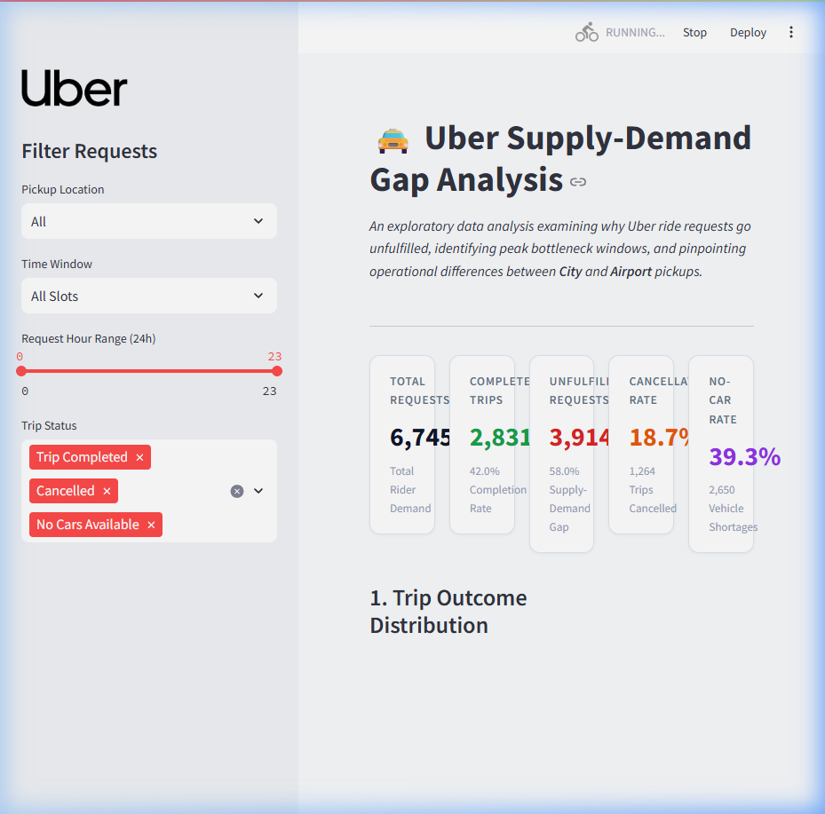

# Uber Supply-Demand Gap Analysis

An exploratory data analysis and SQL case study examining why Uber ride requests go unfulfilled, when cancellations and car shortages occur, and how ride availability differs between the City and the Airport.



---

## About the Project

This is a personal Data Analyst portfolio project where I analyze 6,745 Uber ride requests. My goal was to find out why so many requests go unfulfilled, identify the peak hours when problems happen, and see how the issues differ between City and Airport pickups.

## Why I Built This

I built this project to practice answering real business questions with data. Ride-hailing platforms experience demand shifts throughout the day, and when riders cannot get a car, it affects both customer experience and driver earnings. I wanted to use Python for data cleaning and exploratory analysis, write SQL queries to answer specific business questions, and build an interactive Streamlit dashboard to share the findings clearly.

## Dataset

The dataset covers **6,745 ride request records** over 5 weekdays (Monday, July 11 to Friday, July 15, 2016).

| Column Name | Type | Description |
| :--- | :--- | :--- |
| `request_id` | Integer | Unique identifier for each ride request |
| `pickup_point` | String | Location category (`City` or `Airport`) |
| `driver_id` | Float / Nullable | Assigned driver ID (empty if no car was found) |
| `status` | String | Trip outcome (`Trip Completed`, `Cancelled`, `No Cars Available`) |
| `request_timestamp` | Datetime | Date and time the ride was requested |
| `drop_timestamp` | Datetime | Date and time the trip ended (empty if not completed) |

### Missing Values and Request Status
Missing values in this dataset are not data entry errors. They tell us at what step a ride ended:
- **`Trip Completed` (2,831 trips):** Both driver ID and drop timestamp are present.
- **`Cancelled` (1,264 trips):** A driver accepted the request (driver ID is present), but the trip was cancelled before completion (drop timestamp is empty).
- **`No Cars Available` (2,650 trips):** No driver was assigned (driver ID is empty), so no trip ever started (drop timestamp is empty).

## Tools Used

- **Python (Pandas, Matplotlib, Seaborn):** Data cleaning, timestamp conversion, grouping, and visualization.
- **SQL (SQLite):** Aggregations, conditional counts (`CASE WHEN`), CTEs, and a window function (`RANK() OVER`).
- **Streamlit & Plotly:** Interactive dashboard with filters for pickup location, time period, and ride status.

## Data Cleaning

1. **Standardized Column Names:** Renamed columns to lowercase snake_case (`request_id`, `pickup_point`, `driver_id`, `status`, etc.).
2. **Parsed Timestamps:** Handled mixed timestamp formats (such as `11/7/16 11:51` and `13-07-2016 08:33:16`) using `pd.to_datetime(..., dayfirst=True)`.
3. **Feature Engineering:**
   - Extracted `request_hour` (0–23), `request_date`, and `day_name`.
   - Created 5 time categories: `Early Morning (12 AM - 5 AM)`, `Morning Rush (5 AM - 10 AM)`, `Midday (10 AM - 5 PM)`, `Evening Rush (5 PM - 10 PM)`, and `Late Night (10 PM - 12 AM)`.
   - Created binary flags (`is_completed`, `is_cancelled`, `is_no_cars`, `is_unfulfilled`) to simplify filtering and SQL checks.

## Exploratory Data Analysis

During the analysis, I focused on five main questions:
1. **Overall Request Performance:** How many requests succeeded versus failed?
2. **Hourly Demand:** Which hours receive the most requests, and which hours experience the most failures?
3. **Location Breakdown:** How do cancellation rates and car shortages compare between the City and the Airport?
4. **Rush Hour Comparison:** How do morning issues differ from evening issues?
5. **Operational Priority:** Does a high failure percentage always mean a large volume problem?

## SQL Queries

I loaded the cleaned data into a local SQLite database (`data/uber.db`) and wrote 8 queries in [`sql/uber_analysis.sql`](sql/uber_analysis.sql).

### Sample Query: Ranking Problem Hours by Location
```sql
WITH LocationHourlyStats AS (
    SELECT 
        pickup_point,
        request_hour,
        COUNT(request_id) AS total_requests,
        SUM(CASE WHEN status != 'Trip Completed' THEN 1 ELSE 0 END) AS unfulfilled_count,
        SUM(CASE WHEN status = 'Cancelled' THEN 1 ELSE 0 END) AS cancellations,
        SUM(CASE WHEN status = 'No Cars Available' THEN 1 ELSE 0 END) AS no_cars_count,
        ROUND(SUM(CASE WHEN status != 'Trip Completed' THEN 1.0 ELSE 0 END) * 100.0 / COUNT(*), 2) AS unfulfilled_rate_pct
    FROM uber_trips
    GROUP BY pickup_point, request_hour
)
SELECT 
    RANK() OVER (ORDER BY unfulfilled_count DESC) AS severity_rank,
    pickup_point,
    request_hour,
    total_requests,
    unfulfilled_count,
    unfulfilled_rate_pct,
    CASE 
        WHEN cancellations > no_cars_count THEN 'Driver Cancellations'
        ELSE 'Car Shortage (No Cars)'
    END AS dominant_issue
FROM LocationHourlyStats
ORDER BY severity_rank ASC
LIMIT 5;
```

**Results:**
| Rank | Pickup Location | Hour | Total Requests | Unfulfilled Trips | Failure Rate (%) | Main Issue |
| :---: | :--- | :---: | :---: | :---: | :---: | :--- |
| **1** | Airport | 18 (6 PM) | 405 | 324 | 80.00% | Car Shortage (No Cars) |
| **2** | Airport | 20 (8 PM) | 378 | 304 | 80.42% | Car Shortage (No Cars) |
| **3** | Airport | 19 (7 PM) | 366 | 283 | 77.32% | Car Shortage (No Cars) |
| **4** | Airport | 21 (9 PM) | 343 | 282 | 82.22% | Car Shortage (No Cars) |
| **5** | City | 8 (8 AM) | 350 | 262 | 74.86% | Driver Cancellations |

All 8 queries were tested in Python and matched the Pandas calculations exactly.

## Dashboard

I created a Streamlit dashboard (`dashboard/app.py`) so anyone can explore the numbers interactively:
- **KPI Summary Cards:** Total Requests, Completed Trips, Unfulfilled Requests, Cancellation Rate, and No Cars Available.
- **Charts:**
  - Trip status breakdown.
  - Completed vs. unfulfilled requests by hour.
  - Hourly cancellation and car shortage rates.
  - City vs. Airport performance comparison.
  - Location and hour failure heatmap.
  - Morning vs. Evening rush comparison.
- **Filters:** Pickup location, time window, hour slider, and ride status.

## Key Findings

### 1. Overall Unfulfilled Requests (58.03%)
- **Total Requests:** 6,745
- **Completed Trips:** 2,831 (41.97%)
- **Unfulfilled Requests:** 3,914 (58.03%)
- Out of all unfulfilled requests:
  - **67.71%** were due to no cars being available (2,650 / 3,914).
  - **32.29%** were due to driver cancellations (1,264 / 3,914).

### 2. Two Different Problem Windows
The data shows two distinct rush periods with completely different failure reasons:

- **Morning Rush (5:00 AM to 9:59 AM / Hours 5–9):**
  - **Total Requests:** 2,103 requests across all locations.
  - **City Pickup Volume:** 1,677 requests.
  - **City Cancellations:** 820 cancellations.
  - **City Cancellation Rate:** **48.90%** (`820 / 1,677`).
  - **Peak Hour:** Hour 7 (7:00 to 7:59 AM) had a **50.77%** cancellation rate (`164 / 323`).
  - **Dataset Share:** **64.87%** of all 1,264 cancellations in the entire dataset happened in the City during these 5 hours (`820 / 1,264`).
  - **Main Issue:** **Driver Cancellations** made up 68.05% of all unfulfilled City requests in the morning (`820 / 1,205`).

- **Evening Rush (5:00 PM to 9:59 PM / Hours 17–21):**
  - **Total Requests:** 2,342 requests across all locations.
  - **Airport Pickup Volume:** 1,800 requests.
  - **Airport Car Shortages:** 1,321 `No Cars Available` requests.
  - **Airport Car-Shortage Rate:** **73.39%** (`1,321 / 1,800`).
  - **Peak Hour:** Hour 18 (6:00 to 6:59 PM) had a **76.30%** car-shortage rate (`309 / 405`).
  - **Dataset Share:** **49.85%** of all 2,650 car shortages in the entire dataset happened at the Airport during these 5 hours (`1,321 / 2,650`).
  - **Main Issue:** **Car Shortages** made up 92.57% of all unfulfilled Airport requests in the evening (`1,321 / 1,427`).

### 3. City vs. Airport (Full 24-Hour Comparison)
- **City (3,507 total requests across 24h):**
  - Completed: 1,504 (42.89%)
  - **Cancelled: 1,066 (30.40%)** — accounts for 84.34% of all cancellations in the dataset (`1,066 / 1,264`).
  - No Cars Available: 937 (26.72%).
  - *Hypothesis (Requires External Data):* The data does not track driver earnings or where drivers go after dropping off a rider. A common hypothesis is that city drivers avoid early morning airport trips because they expect few returning riders from the airport, risking an unpaid drive back. Testing this would require flight schedules and driver location logs.

- **Airport (3,238 total requests across 24h):**
  - Completed: 1,327 (40.98%)
  - Cancelled: 198 (6.11%).
  - **No Cars Available: 1,713 (52.90%)** — accounts for 64.64% of all car shortages in the dataset (`1,713 / 2,650`).
  - *Hypothesis (Requires External Data):* The dataset does not track flight arrivals or cars waiting near the airport. The high number of shortages suggests that passenger demand outstrips available cars nearby in the evening. Testing this would require flight timetables and queue logs.

### 4. Failure Count vs. Failure Percentage
Early morning hours between 1:00 AM and 3:00 AM show failure rates over 65%, but only represent 80–90 total requests (for example, Hour 1 has 60 unfulfilled requests out of 85). In contrast, Hour 18 (6:00 to 7:00 PM) has 510 requests and **346 unfulfilled trips** (`346 / 510` = 67.84%). Looking at total unfulfilled volume helps focus on the hours where the most riders are affected.

## What I Learned

- How to understand the operational context behind missing values instead of immediately dropping rows.
- The importance of comparing failure volume alongside failure rates to prioritize problem hours accurately.
- How to write clean SQL queries using CTEs and window functions to rank multi-variable metrics.
- How to build a simple, responsive dashboard in Streamlit and Plotly to make data easy to explore.

## How to Run the Project

### 1. Clone the Repository
```bash
git clone https://github.com/Karunesh17/Exploratory-Data-Analysis-on-Uber-Supply-Demand-Gap.git
cd Exploratory-Data-Analysis-on-Uber-Supply-Demand-Gap
```

### 2. Install Dependencies
```bash
pip install -r requirements.txt
```

### 3. Run Data Cleaning & SQL Checks
```bash
python data/clean_data.py
python sql/execute_sql.py
```

### 4. Launch the Dashboard
```bash
streamlit run dashboard/app.py
```

### 5. Open the Notebook
```bash
jupyter notebook notebooks/uber_supply_demand_analysis.ipynb
```
